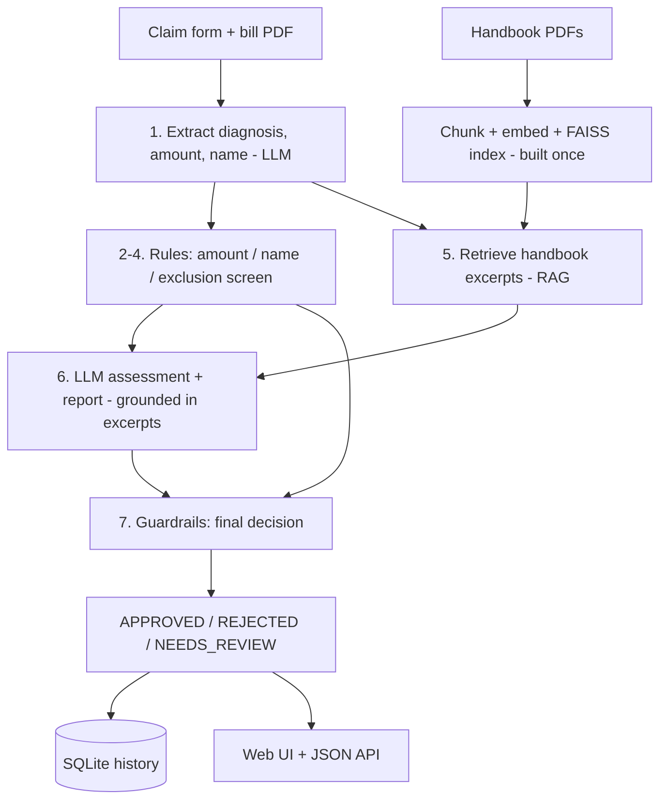

# ClaimTrackr - AI-Powered Medical Insurance Claim Verification

An end-to-end GenAI system that validates medical insurance claims against a BUPA membership handbook using
**RAG (retrieval-augmented generation) + FAISS + an LLM**, with deterministic business rules and guardrails around it.

A user submits a claim form and a medical bill (PDF). The system reads the bill, checks the numbers, screens the
diagnosis against the policy's exclusions, retrieves the relevant handbook pages, has an LLM write a grounded report,
and returns **APPROVED / REJECTED / NEEDS_REVIEW** with a step-by-step trace and the handbook pages it relied on.

## How it works



| Step | What happens | Code |
|---|---|---|
| Index (once) | Handbook PDFs -> 1000-char chunks (200 overlap) with file + page -> embeddings -> FAISS | `rag.py`, `chunking.py`, `embeddings.py` |
| 1 | LLM extracts patient name, diagnosis, billed amount from the bill | `llm.py` |
| 2-4 | Rules: claimed <= billed, claimant matches bill, diagnosis not on exclusion list | `rules.py` |
| 5 | Retrieve handbook excerpts: required documents, general exclusions, and one query specific to this diagnosis | `processor.py` |
| 6 | LLM returns a structured verdict + report using only those excerpts | `llm.py`, `prompts.py` |
| 7 | Guardrails: rules always win, the LLM can only make a decision stricter, anything unclear goes to a human | `processor.py` |

## Quick start (macOS / Linux)

```bash
python3 -m venv claimenv
source claimenv/bin/activate          # Windows: claimenv\Scripts\activate
pip install -r requirements.txt
cp .env.example .env                  # optional, only needed for a real LLM

python -m claimtrackr.cli demo -v     # run 5 sample claims in the terminal, see every step
python app.py                         # web app -> http://127.0.0.1:8081
pytest -q                             # 30 tests
```

With no API key it runs in **offline demo mode**: TF-IDF hashing embeddings + a rule-based stand-in for the LLM.
The retrieval, FAISS index, rules, guardrails, web app and database are all real in this mode; only the bill
extraction and report writing are templated instead of written by an LLM. The UI says so on every report.

### Use a real LLM
```bash
# .env
OPENAI_API_KEY=your-key
```
That is all: with a key the app switches to OpenAI embeddings + `gpt-4o-mini` automatically (change with
`OPENAI_CHAT_MODEL`). Delete the `faiss_index/` folder or run `python -m claimtrackr.cli index` once so the index
is rebuilt with the new embeddings (it also rebuilds itself automatically when it detects the change).
Any OpenAI-compatible server works through `OPENAI_BASE_URL` (OpenRouter, or a free local Ollama server).

## Demo script (5 minutes)

Run `python app.py` and open http://127.0.0.1:8081. The home page has a **Try a sample** panel: download a bill (PDF),
press **Fill form**, then choose the downloaded file. The bills are also in `sample_bills/`:

| # | Bill | Name | Amount | Expected | What it shows |
|---|---|---|---|---|---|
| 0 | Test_Bill_ViralFever.pdf | Anita Rao | 2500 | APPROVED | a brand-new bill, every step passes |
| 1 | Bodyache.pdf | Surbhit | 3000 | APPROVED | the happy path: every step passes |
| 2 | HIV.pdf | Surbhit | 3000 | REJECTED | exclusion screen + handbook exclusion page retrieved |
| 3 | Alzheimer.pdf | Surbhit | 3000 | REJECTED | same, with a different spelling ("Alzheimer's" vs the list) |
| 4 | Bodyache.pdf | Surbhit | 9000 | REJECTED | claimed more than billed (3,150) |
| 5 | Bodyache.pdf | Rahul Sharma | 3000 | REJECTED | claimant does not match the bill |

On each result page open **"Handbook excerpts used"** to show the RAG evidence, then **History** to show the audit trail.
JSON API: `curl -F name=Surbhit -F total_claim_amount=3000 -F medical_bill=@sample_bills/Bodyache.pdf http://127.0.0.1:8081/api/verify`

## Project structure
```
app.py                  Flask app: form, result page, /api/verify, /history, /health
claimtrackr/
  processor.py          THE workflow (start reading here)
  rules.py              amount / name / exclusion checks (deterministic)
  rag.py                FAISS index: build, save, load, search
  chunking.py           recursive text splitter
  embeddings.py         OpenAI embeddings + offline TF-IDF fallback
  llm.py, prompts.py    OpenAI backend + offline stand-in, prompt templates
  storage.py            SQLite claim history
  cli.py                terminal demo
documents/              knowledge base: BUPA handbook PDFs
sample_bills/           3 test bills        sample_data/  demo cases
templates/, static/     UI (plain HTML/CSS/JS, no frameworks, works offline, light + dark mode)
tests/                  pytest suite (30 tests)
docs/INTERVIEW_GUIDE.md how to explain this project
```

## What changed from the first version
| First version | This version |
|---|---|
| Rebuilt the FAISS index (and paid for embeddings) on every request; the saved index was never loaded | Built once, saved, reloaded; auto-rebuilds only if PDFs or embedding model change |
| Free-text LLM answer; verdict was buried in prose | Structured JSON verdict + report, validated before use |
| `claimed == billed` hit the "invalid receipt" branch | Fixed; amounts parsed robustly (`Rs. 3,150.00`) |
| "Heart disease" scored 0.5 against "Parkinson's disease" (shared word "disease") and was rejected | Generic words ignored in the exclusion screen |
| LLM output rendered with `\| safe` (HTML injection) | Auto-escaped |
| API key stored in `config.yaml` | Environment variable / `.env` (git-ignored) |
| Patient info and sample bill sat inside the knowledge base | Knowledge base = handbooks only |
| LLM failure = crash | Fails safe to NEEDS_REVIEW; rule-based rejections still work |

## Known limitations
- Scanned/image PDFs have no text layer and go to NEEDS_REVIEW (OCR is a natural next step).
- The exclusion screen is lexical, so synonyms ("senile dementia") rely on the LLM layer to catch them.
- Max claim limits, benefit schedules and waiting periods from the handbook are not modelled as rules yet.
- No labelled evaluation set yet; the 5 demo cases are smoke tests, not an accuracy measurement.
- Handbook contains English and Chinese pages; the offline embedder only understands English.
- Sample data is fictional. Real claims contain personal health data, so a production system would need access control,
  encryption, retention rules and a review of what is sent to an external LLM.
